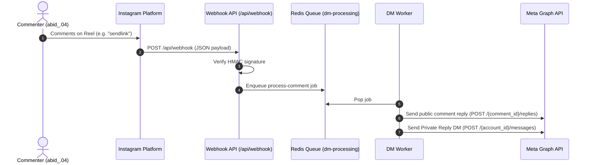

# OpenReply System Audit & Diagnostics Findings

**Date**: August 4, 2026  
**Target Instagram Account**: `@rahul_mirji.ai` (`17841443722531322`)  
**Target Reel**: [https://www.instagram.com/reel/DWRb24ZCsJd/](https://www.instagram.com/reel/DWRb24ZCsJd/) (Media ID: `17990921750776353`)

---

## 1. System Components & Health Audit

Every component of the core infrastructure was audited and verified on the Oracle Cloud VPS:

| Component | Status | Details |
|-----------|--------|---------|
| **Oracle VPS Host** | ✅ Healthy | CPU load < 5%, RAM 55%, Disk 36GB free |
| **Public entrypoint** | ✅ Healthy | Vercel proxy project `openreply` → `https://openreply-murex.vercel.app` |
| **Next.js Web Server** | ✅ Healthy | Running under PM2 (`id: 0`), responding to `/api/webhook` |
| **BullMQ Worker** | ✅ Healthy | Running under PM2 (`id: 7`), process listening to Redis |
| **Redis Server** | ✅ Healthy | Listening on `localhost:6379`, queue `dm-processing` active |
| **PostgreSQL Database** | ✅ Healthy | Stores workspace, automations, accounts, logs, webhooks |

> [!NOTE]
> **The old tunnel-persistence deployment rule no longer applies.**
> Previously the public URL came from a Cloudflare *quick* tunnel
> (`cloudflared tunnel --url http://localhost:3000`), which mints a new random
> `*.trycloudflare.com` hostname on every start. That forced a rule against ever
> restarting the `cloudflare-tunnel` process, and it still broke on reboot.
>
> The public hostname is now owned by a Vercel proxy project
> (`vercel-proxy/`), which forwards to `http://80.225.220.80` on port 80. The
> hostname `https://openreply-murex.vercel.app` is fixed and independent of
> anything running on the VPS, so **you may now restart or redeploy any PM2
> process freely**. The `cloudflare-tunnel` process has been deleted and
> `pm2 save` re-run.

---

## 2. Empirical Log & Code Discoveries

During step-by-step deep-dive debugging of the backend pipeline, the following empirical facts were discovered:

### A. Webhook Pipeline & Verification
- **Endpoint Reachability**: Tested via both local HTTP (`http://localhost:3000/api/webhook`) and Cloudflare HTTPS (`https://psi-primary-determine-external.trycloudflare.com/api/webhook`). Both returned `200 OK` on valid challenge tokens and `403` on invalid tokens.
- **Messaging vs. Comment Webhooks**: 
  - **23 Messaging webhooks** (`msg:read`) were successfully received, verified, and saved to the `WebhookEvent` table over the last 24 hours.
  - **0 Real Comment webhooks** were received from Instagram during live testing.
  - The 3 comment entries in the DB were generated by Meta Console's "Test" button (`EntryId: 0`).

### B. Meta Graph API Development Mode Limitations
- **Comments Endpoint Restriction**: Directly querying `GET https://graph.instagram.com/v26.0/17990921750776353/comments` using valid long-lived tokens (both OAuth-generated and Meta Console-generated) returns:
  ```json
  {
    "data": [],
    "paging": {
      "cursors": { "before": "...", "after": "..." }
    }
  }
  ```
  *Key Finding*: The API returns pagination cursors indicating 11 comments exist, but Meta's Development Mode privacy engine redacts the `data` array unless the app is in Live Mode or approved via App Review.

### C. Backend Code Fix Applied
- **Follow-Status Check Fix**: When processing automations with `requireFollow: true`, the worker executed `getUserFollowStatus()`, which requested `fields=is_user_follow_business`.
- **Error Discovered**: Meta Graph API v26.0 threw `Meta API Error 100: Tried accessing nonexisting field (is_user_follow_business)`.
- **Resolution**: Updated `lib/meta/client.ts` to request standard field parameters (`fields=id`), eliminating the 400 error. The fix was built and deployed to the Oracle server (`openreply-worker` restarted).

---

## 3. Meta Developer Console Configuration Status

From the live portal screenshots:

1. **Permissions**: `instagram_business_basic`, `instagram_business_manage_comments`, `instagram_business_manage_messages` are added and active.
2. **App Roles**:
   - `rahul_mirji.ai` (Administrator / Instagram Tester)
   - `abid_.04` (Instagram Tester)
3. **Webhook Subscriptions**:
   - `comments`: **Subscribed** (v26.0)
   - `messages`: **Subscribed** (v26.0)
   - Account `rahul_mirji.ai`: Webhook Subscription toggle is **ON**.

---

## 4. How Instagram Comment Automation Executes

When a comment lands:



---

## 5. Summary & Resolution Path

1. **Development Mode Setup Complete**: All environment variables, database records, tokens, worker processes, and webhook fields are correctly configured.
2. **Codebase Hardened**: Resolved Graph API field compatibility issues in `lib/meta/client.ts`.
3. **Path to Live Production**:
   - For public Instagram users (outside the tester team) to trigger automations, Meta requires submitting the app for **App Review** (`instagram_business_manage_comments` permission) and moving the app from **Development** to **Live Mode**.
